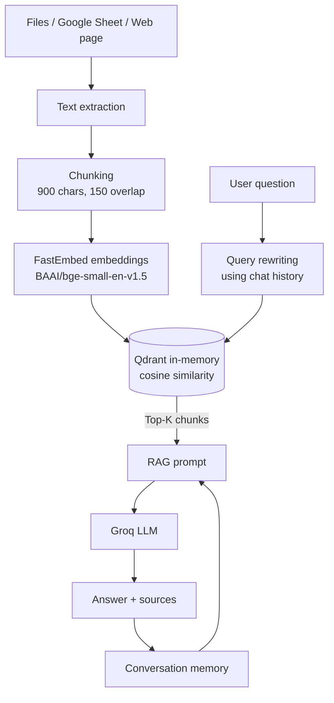

# 🤖 AI Knowledge Assistant

**A multi-source RAG chatbot that answers questions from your own documents and remembers the conversation.**


## 1. Problem

Company and personal knowledge lives in many formats: PDFs, slide decks, spreadsheets, web pages. Searching each one by hand is slow, and generic chatbots don't know your documents and tend to make things up.

Most simple RAG demos also fail on **follow-up questions**. Ask "What about the second one?" and retrieval returns nothing useful, because that sentence means nothing without the previous turn.

**This project:**
- Lets you chat with your own documents from many source types in one place
- Answers only from the retrieved knowledge, and says so when the answer isn't there
- Handles follow-ups by rewriting each question into a standalone search query using the chat history

## 2. Architecture



**How a question is answered**

1. If there is chat history, the LLM rewrites the question into a standalone search query.
2. The query is embedded, and the top-K most similar chunks are retrieved from Qdrant.
3. The chunks and the full chat history are inserted into the prompt.
4. The LLM answers from that context, and the exchange is saved to memory.

## 3. Data / Knowledge Sources

This project doesn't ship with a fixed dataset. **You bring your own knowledge**, and the app indexes it at runtime.

| Source | How it's processed |
|---|---|
| PDF | One record per page |
| PowerPoint (`.pptx`) | One record per slide, including tables |
| Word (`.docx`) | Paragraphs and tables |
| TXT / Markdown | Whole file |
| CSV | One record per row, formatted as `column: value` |
| Excel (`.xlsx`) | One record per row, per sheet |
| JSON | Whole document |
| Google Sheets | Exported as CSV (sheet must be viewable by anyone with the link) |
| Web page | Visible text, with scripts and styles removed |

Every chunk keeps its source and location (page, slide, row), which is what powers the source display in answers.

## 4. Tech Stack

| Layer | Tool |
|---|---|
| UI | Streamlit |
| LLM | Groq (`openai/gpt-oss-20b` by default) via LangChain |
| Embeddings | FastEmbed, `BAAI/bge-small-en-v1.5` |
| Vector database | Qdrant (local in-memory mode) |
| Memory | LangChain `InMemoryChatMessageHistory` |
| Parsing | `pypdf`, `python-pptx`, `python-docx`, `openpyxl`, `BeautifulSoup` |

## 5. How to Run

**Install**

```bash
git clone https://github.com/AmrT9/ai-knowledge-assistant.git
cd ai-knowledge-assistant

python -m venv .venv
# Windows
.venv\Scripts\activate
# macOS / Linux
source .venv/bin/activate

pip install -r requirements.txt
```

**Add your Groq API key.** Get one from the [Groq Console](https://console.groq.com), copy `.env.example` to `.env`, and set:

```env
GROQ_API_KEY=gsk_your_real_key_here
```

**Run**

```bash
streamlit run app.py
```

The first run downloads the embedding model (about 67 MB).

**Use it**

1. Upload files in the sidebar and/or paste a Google Sheet or web page URL.
2. Click **Build Knowledge Base**.
3. Ask a question, then a follow-up like *"What about the second one?"*
4. Open **Retrieval details** to see the rewritten query and the sources used.

**Optional settings** (in `.env`)

| Variable | Default | Description |
|---|---|---|
| `GROQ_MODEL` | `openai/gpt-oss-20b` | Groq model for answers and query rewriting |
| `EMBEDDING_MODEL` | `BAAI/bge-small-en-v1.5` | FastEmbed model |
| `TOP_K` | `4` | Chunks retrieved per question |
| `CHUNK_SIZE` | `900` | Characters per chunk |
| `CHUNK_OVERLAP` | `150` | Overlap between chunks |

## 6. Results

<!-- Fill this in with your real test results. Example table below. -->

Tested on: _describe your test set, e.g. "5 documents (2 PDFs, 1 PPTX, 1 CSV, 1 web page), 20 questions"_

| Metric | Result |
|---|---|
| Questions answered correctly from sources | _x / y_ |
| Follow-up questions resolved correctly | _x / y_ |
| Questions outside the knowledge base correctly declined | _x / y_ |
| Average response time | _x s_ |

**Example: follow-up handling**

| Turn | Question | Rewritten search query |
|---|---|---|
| 1 | _your first question_ | _(unchanged)_ |
| 2 | What about the second one? | _paste the rewritten query from Retrieval details_ |

## 7. Screenshots / Diagrams

<!-- Add images to a /docs folder and reference them like this -->

| Knowledge base built | Chat with follow-up | Retrieval details |
|---|---|---|
|  |  |  |

The architecture diagram is in [Section 2](#2-architecture).

## 8. What I Personally Built

I designed and implemented the whole system end to end:

- **Multi-source ingestion:** extractors for PDF, PPTX, DOCX, TXT/MD, CSV, XLSX, JSON, Google Sheets, and web pages, each preserving its source and location metadata
- **Chunking:** a sentence-aware chunker with overlap
- **Vector search pipeline:** FastEmbed embeddings stored in an in-memory Qdrant collection with cosine similarity
- **Query rewriting:** an LLM step that turns follow-ups into standalone search queries using the chat history
- **Grounded RAG prompt:** instructions that keep answers tied to retrieved context and decline when the answer isn't available
- **Conversational memory:** full chat history carried across turns
- **Streamlit interface:** sidebar for building the knowledge base, chat view, and a retrieval details panel for debugging

## Limitations

- No OCR or audio/video support, so scanned PDFs and images aren't read.
- The knowledge base is in memory and is rebuilt when the app restarts.
- Web pages are read as static HTML, so JavaScript-rendered content is missed.

## Next Steps

- Persistent Qdrant storage
- Streaming responses
- Inline citations in answers
- OCR for scanned documents
- A small evaluation set to track retrieval quality

---

Built by [Amr](https://github.com/AmrT9)
